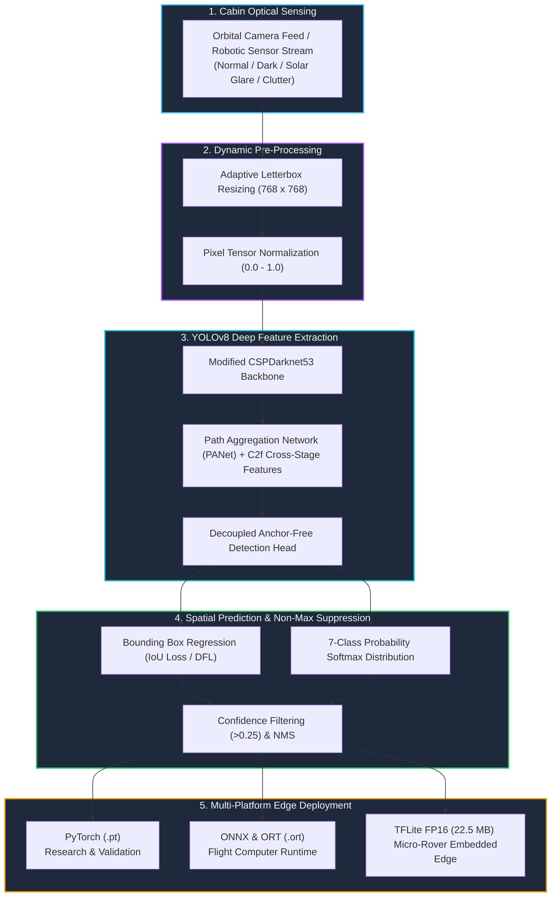
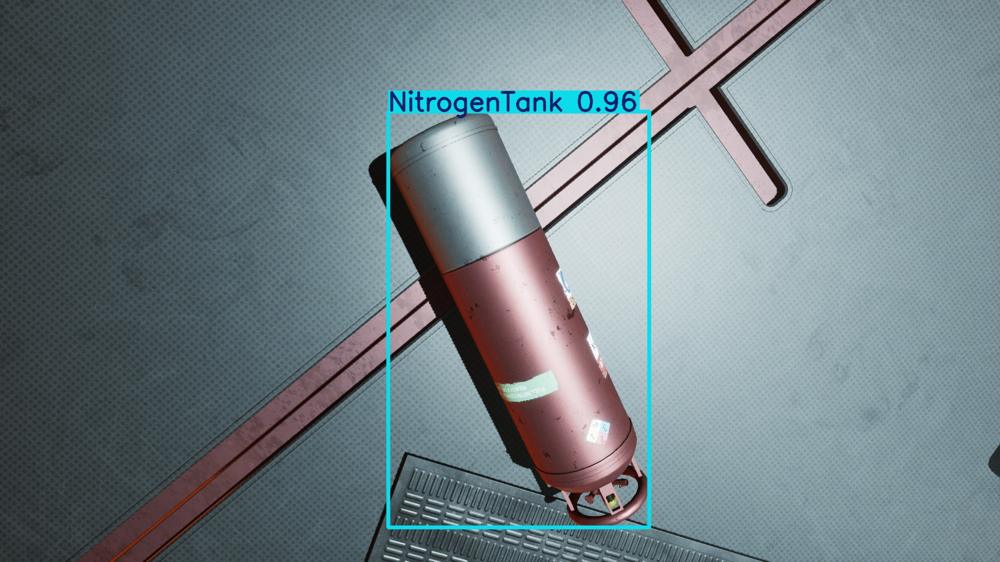
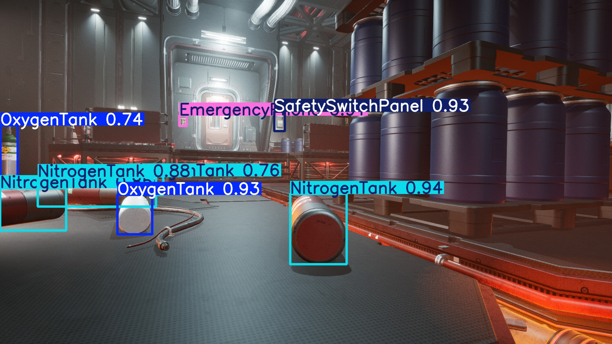
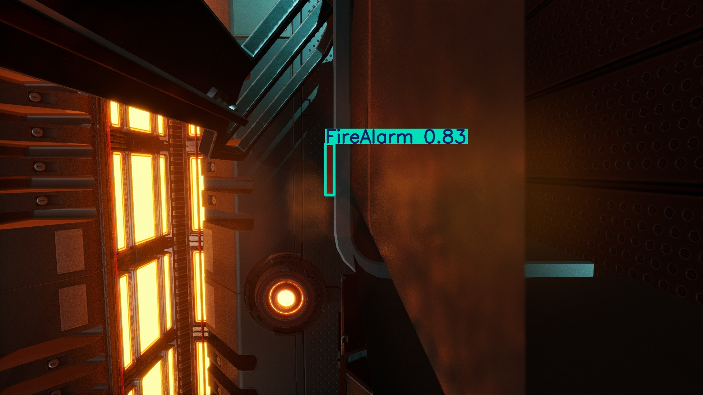
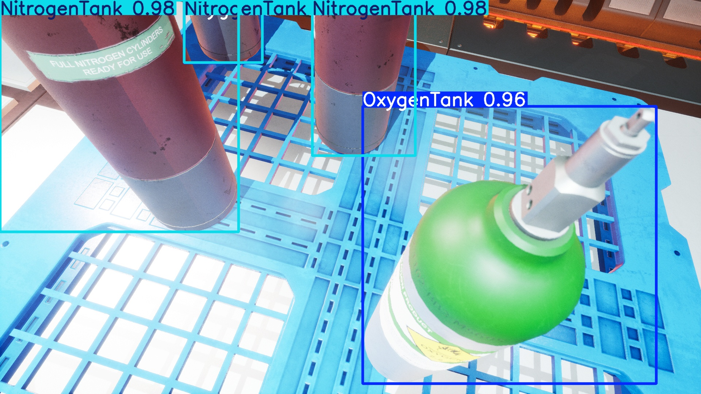
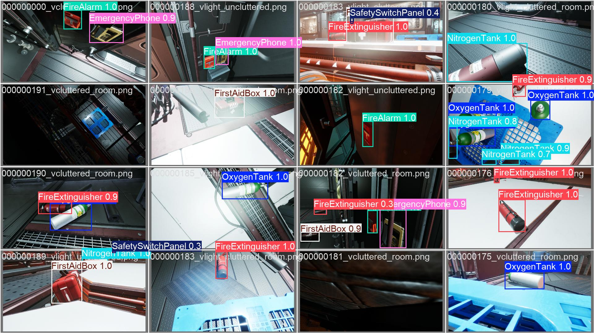
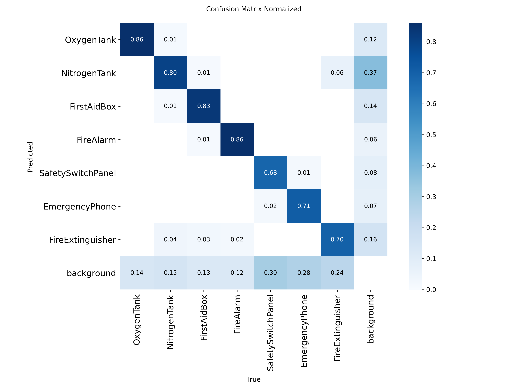
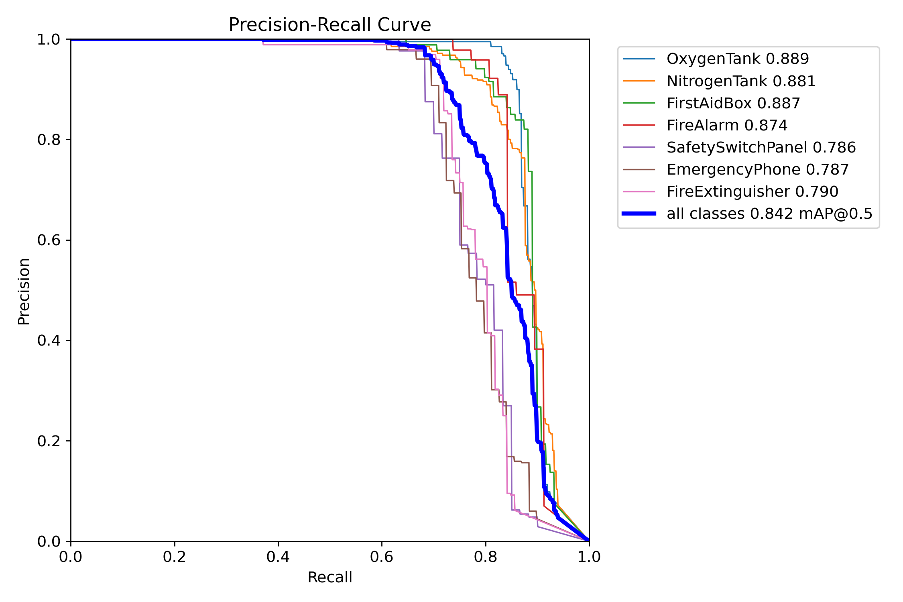
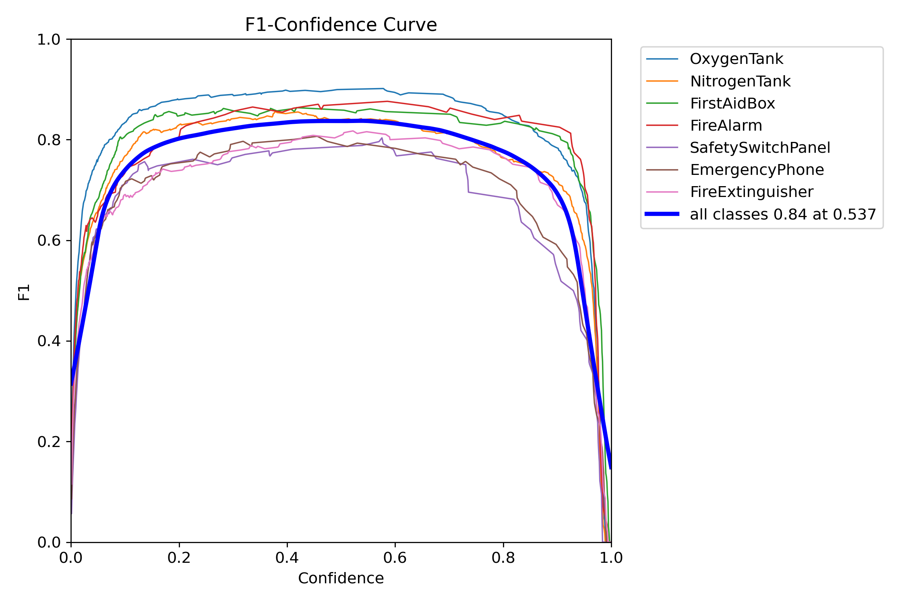
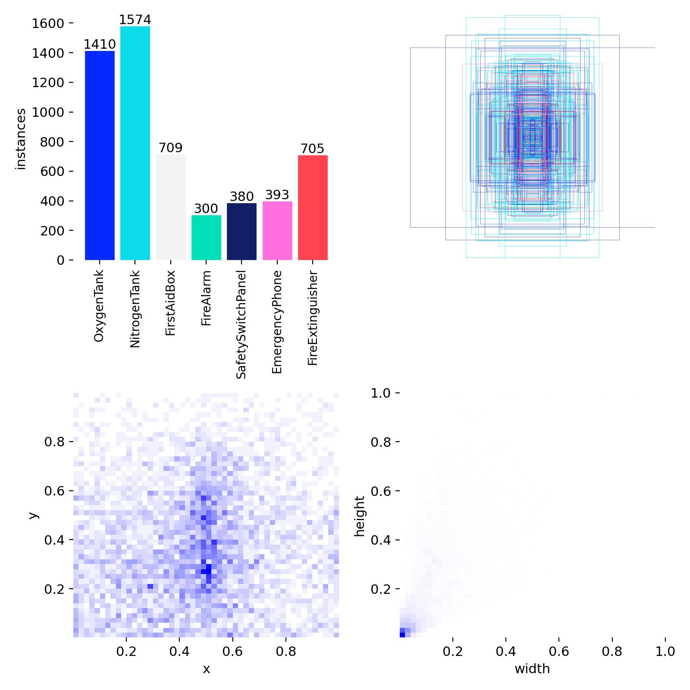

<div align="center">

# 🛰️ AstroVision-YOLOv8
### Autonomous Computer Vision for Space Station Life Support & Safety Equipment

[](https://www.python.org/)
[-00FFFF?style=for-the-badge&logo=ultralytics&logoColor=black)](https://docs.ultralytics.com/)
[](https://pytorch.org/)
[](https://onnxruntime.ai/)
[-FF6F00?style=for-the-badge&logo=tensorflow&logoColor=white)](https://www.tensorflow.org/lite)
[](LICENSE)

<br/>

**A deep-learning vision system engineered to localize, detect, and classify critical emergency hardware inside pressurized spacecraft modules across extreme lighting shifts and dense microgravity clutter.**

<br/>

| 🎯 Target Classes | 🏆 Peak Precision | 📈 mAP @ 0.50 | 🧪 Evaluated Test Images |
|:---:|:---:|:---:|:---:|
| **7 Life-Support Assets** | **95.85%** | **84.20%** | **1,408 Environmental Scenarios** |

</div>

---

## 📌 Executive Summary: Why This Matters

Inside pressurized orbital habitats (such as the **International Space Station**, **Lunar Gateway**, and commercial space stations), emergencies such as rapid cabin depressurization, electrical fires, toxic atmospheric leaks, or thermal runaway require sub-second responses. 

Astronauts facing smoke-filled cabins or disorienting emergency strobe lighting cannot afford to search for equipment. Moreover, autonomous free-flying intra-vehicular robots (e.g., **NASA Astrobee**, **ESA CIMON**) require an onboard, low-latency visual perception engine capable of identifying and navigating to safety gear autonomously.

> [!IMPORTANT]
> **Core Engineering Hurdle**: Orbital interiors feature drastic illumination swings—from pitch-black power shutdowns (`vdark`) to intense solar glare through cupolas (`vlight`)—combined with chaotic floating cables, scientific payload racks, and loose cargo bags (`clutter`).

This project solves this challenge by developing, benchmarking, and packaging a high-resolution ($768\times768$) **YOLOv8-Small** detector optimized for real-time edge execution on flight computers.

---

## 🛠️ System Architecture & Inference Pipeline

The diagram below details the operational flow from the intra-vehicular camera feed down to real-time embedded robotic actuation:



---

## 🎯 7 Critical Safety Equipment Classes

The detector is trained to identify and track seven essential categories of safety and environmental maintenance hardware:

| Class ID | Equipment | Icon | Operational Function in Spaceflight | Priority |
|:---:|:---|:---:|:---|:---:|
| **0** | `OxygenTank` | 🫁 | Primary breathing atmospheric supply & emergency repressurization | `CRITICAL` |
| **1** | `NitrogenTank` | 🧪 | Buffer gas control & atmospheric partial-pressure balancing | `HIGH` |
| **2** | `FirstAidBox` | 🩹 | Medical trauma kit, pressure dressings, & radiation countermeasures | `HIGH` |
| **3** | `FireAlarm` | 🚨 | Multi-spectral optical smoke & thermal decomposition sensor | `CRITICAL` |
| **4** | `SafetySwitchPanel` | ⚡ | Master electrical bus disconnect & power circuit isolation | `CRITICAL` |
| **5** | `EmergencyPhone` | 📞 | Hardwired inter-module comms & ground control communication | `HIGH` |
| **6** | `FireExtinguisher` | 🧯 | Active fire suppression ($\text{CO}_2$ / non-conductive fine water-mist) | `CRITICAL` |

---

## 🖼️ Visual Detection Showcase

The detector was stress-tested across **1,408 test scenes** to verify zero false negatives during environmental anomalies:

### Multi-Condition Performance Comparison

| 🌒 Scenario: Dimmed Module + Heavy Clutter | 🌑 Scenario: Emergency Blackout (`vdark`) |
|:---:|:---:|
|  |  |
| **Condition**: Low ambient cabin lighting with floating cargo & tools.<br/>**Detection**: Accurate bounding box localization without shadow confusion. | **Condition**: Power bus failure / emergency red backup lighting.<br/>**Detection**: Detects safety panel and alarms in near-pitch darkness. |

| 💡 Scenario: Nominal Cabin Passageway | ☀️ Scenario: Severe Solar Glare / High Exposure |
|:---:|:---:|
|  |  |
| **Condition**: Standard daylight module illumination.<br/>**Detection**: Clean separation of proximate equipment with >90% confidence. | **Condition**: Direct unattenuated solar radiation / glare.<br/>**Detection**: Resilient against highlight clipping and lens flaring. |

---

### 🔍 Batch Prediction Mosaic

Below is a validation mosaic showing multi-target detection across varied module geometries:

<div align="center">
  
  <p><em>Figure 1: Automated multi-target localization overlay from validation batch inference.</em></p>
</div>

---

## 📈 Benchmarks & Quantitative Evaluation

### Model Evolution: Baseline vs. High-Resolution Model

Switching from a standard $640\times640$ baseline to a high-resolution $768\times768$ grid provided the spatial fidelity necessary to identify smaller switchboards, alarm buttons, and labels down long corridors.

```
Metric Progression (Baseline 640px vs Final 768px):

mAP @ 0.50       [███████████████████░░░░░░░░░] 65.49% (Baseline)
                 [█████████████████████████░░░] 84.20% (Final Model)  (+18.71%)

Precision        [████████████████████████░░░░] 80.98% (Baseline)
                 [████████████████████████████] 95.85% (Final Model)  (+14.87%)

Recall           [█████████████████░░░░░░░░░░░] 58.46% (Baseline)
                 [███████████████████████░░░░░] 75.48% (Final Model)  (+17.02%)
```

### Detailed Evaluation Metrics Table

| Metric | Baseline (`baseline_train`) | Final Model (`epoch14_final`) | Final Epoch (Epoch 16) | Delta (Final vs. Base) |
|:---|:---:|:---:|:---:|:---:|
| **Image Resolution** | $640 \times 640$ | $\mathbf{768 \times 768}$ | $\mathbf{768 \times 768}$ | $+128\text{ px}$ |
| **Precision (B)** | $80.98\%$ | $\mathbf{92.57\%}$ | $\mathbf{95.85\%}$ | **$+14.87\%$** |
| **Recall (B)** | $58.46\%$ | $\mathbf{75.48\%}$ | $74.65\%$ | **$+17.02\%$** |
| **mAP @ 0.50** | $65.49\%$ | $\mathbf{83.42\%}$ | $\mathbf{84.20\%}$ | **$+18.71\%$** |
| **mAP @ 0.50:0.95** | $52.46\%$ | $\mathbf{72.00\%}$ | $\mathbf{72.45\%}$ | **$+19.99\%$** |
| **Validation Box Loss** | $0.6162$ | $\mathbf{0.4479}$ | $0.4506$ | **$-27.3\%$** |
| **Validation Class Loss** | $0.7867$ | $\mathbf{0.4951}$ | $0.4750$ | **$-39.6\%$** |

---

## 🔬 Diagnostic Curves & Telemetry

<div align="center">

| Normalized Confusion Matrix | Precision-Recall (PR) Curve |
|:---:|:---:|
|  |  |
| *Demonstrates high diagonal precision across all 7 equipment classes with minimal background confusion.* | *Precision-Recall trade-off curve across all confidence thresholds.* |

| F1-Confidence Curve | Dataset Bounding Box Spatial Telemetry |
|:---:|:---:|
|  |  |
| *Peak F1-score achieved across optimal confidence band ($\approx 0.4 - 0.7$).* | *Spatial box location density, class distribution, and aspect ratio spread.* |

</div>

---

## 🧪 Environmental Robustness Matrix

The 1,408 test evaluations are distributed across 6 environmental stress profiles:

```
Total Test Benchmarks: 1,408 images

Lighting Breakdown:
├── Dark Modules (Dimmed Habitats)       : 718 images (51.0%)
├── Nominal Light (Standard Operational) : 488 images (34.7%)
├── Extreme Low-Light (vdark blackout)   : 120 images (8.5%)
└── High Glare / Direct Sun (vlight)     :  82 images (5.8%)

Clutter Breakdown:
├── Passageway Clear (Uncluttered)       : 876 images (62.2%)
└── Operational Clutter (Payload / Bags) : 532 images (37.8%)
```

---

## 🚀 Low-SWaP Spaceflight Edge Deployment

Flight computers on orbital stations and rovers have strict Size, Weight, and Power (SWaP) budgets. To support real-time robotic systems without requiring power-hungry desktop GPUs, this project ships with ready-to-deploy optimized models:

| Format | Target File | File Size | Memory Footprint | Target Flight Platform |
|:---|:---|:---:|:---:|:---|
| **PyTorch** | [`epoch14_final.pt`](epoch14_final.pt) | $67.2\text{ MB}$ | High | Server / Ground Station / Retraining |
| **ONNX** | [`epoch14_final.onnx`](epoch14_final.onnx) | $45.0\text{ MB}$ | Medium | Cross-Platform x86/ARM Flight Nodes |
| **ONNX Runtime** | [`epoch14_final.ort`](epoch14_final.ort) | $44.9\text{ MB}$ | Low | Optimized Edge Run-Time Engine |
| **TFLite (FP32)** | [`epoch14_final_saved_model/epoch14_final_float32.tflite`](epoch14_final_saved_model/epoch14_final_float32.tflite) | $44.9\text{ MB}$ | Low | Embedded ARM SBCs / Jetson Nano |
| **TFLite (FP16)** | [`epoch14_final_saved_model/epoch14_final_float16.tflite`](epoch14_final_saved_model/epoch14_final_float16.tflite) | **$22.5\text{ MB}$** | **Ultra-Low (-50%)** | Autonomous Free-Flyers (e.g. Astrobee) |

### ✂️ Kernel Operator Pruning

To compile a stripped-down ONNX Runtime binary with no unused operator bloat, [`epoch14_final.required_operators.config`](epoch14_final.required_operators.config) specifies the exact **15 ONNX operators** required by the model:

```
ai.onnx:   Concat, Sigmoid, Softmax, Add, Div, Mul, Sub, Split, Resize, Reshape, Transpose, Conv, MaxPool, Slice
com.microsoft: QuickGelu
```

---

## 💻 Quick Start & Usage

### 1. Clone & Set Up Virtual Environment

```bash
# Clone the repository
git clone https://github.com/shashankchaurasiya27-boop/space-station-vision-yolov8.git
cd space-station-vision-yolov8

# Create & activate a virtual environment
python3 -m venv venv
source venv/bin/activate

# Install dependencies
pip install -r requirements.txt
```

### 2. Run Inference

Predict on curated sample images (or any folder, single image, or video stream):

```bash
# Run on curated test images
python predict.py --source assets/sample_predictions --conf 0.25 --imgsz 768

# Run on a custom image or video using the best model weights
python predict.py --source /path/to/cabin_image.jpg --weights epoch14_final.pt --conf 0.35
```

### 3. Interactive Dataset Visualizer

Inspect ground truth bounding boxes and annotations with OpenCV:

```bash
python visualize.py --dataset . --mode train
```

* **Keyboard Shortcuts**:
  * <kbd>A</kbd> / <kbd>D</kbd> : Previous / Next image
  * <kbd>T</kbd> / <kbd>V</kbd> : Toggle Train / Validation split
  * <kbd>Q</kbd> / <kbd>ESC</kbd> : Exit visualizer

### 4. Reproduce Training

Run reproducible training with automatic device selection (Apple Silicon MPS, NVIDIA CUDA, or CPU):

```bash
python train.py \
  --weights yolov8s.pt \
  --epochs 25 \
  --imgsz 768 \
  --batch 16 \
  --optimizer AdamW \
  --lr0 1e-4 \
  --mosaic 0.4 \
  --device auto
```

---

## 📁 Repository Directory Structure

```
space-station-vision-yolov8/
├── README.md                                               # Technical documentation & project portfolio
├── LICENSE                                                 # Open-source MIT License
├── requirements.txt                                        # Pinned Python package dependencies
├── classes.txt                                             # 7 target class names
├── yolo_params.yaml                                        # Dataset configuration file
│
├── train.py                                                # Cross-platform training script (MPS/CUDA aware)
├── predict.py                                              # Inference pipeline with speed telemetry
├── visualize.py                                            # Interactive dataset visualizer GUI
│
├── epoch14_final.pt                                        # Primary PyTorch model weights (Best checkpoint)
├── epoch14_final.onnx                                      # Standard ONNX model graph
├── epoch14_final.ort                                       # Optimized ONNX Runtime flatbuffer
├── epoch14_final.with_runtime_opt.ort                      # Graph-optimized ORT model
├── epoch14_final.required_operators.config                 # Kernel pruning operator list
├── calibration_image_sample_data_20x128x128x3_float32.npy # Sample calibration array for INT8 PTQ
│
├── epoch14_final_saved_model/                              # TensorFlow export directory
│   ├── epoch14_final_float16.tflite                        # FP16 half-precision mobile model (22.5 MB)
│   ├── epoch14_final_float32.tflite                        # FP32 standard mobile model (44.9 MB)
│   └── metadata.yaml                                       # Ultralytics model metadata
│
├── assets/                                                 # Visual demonstration assets
│   ├── sample_predictions/                                 # Environmental test sample images & mosaic
│   └── metrics/                                            # Confusion matrices, PR curves, F1 curves
└── runs/                                                   # Experiment history and run telemetry
```

---

## 👤 Author

* **Shashank Chaurasia** — [GitHub Profile](https://github.com/shashankchaurasiya27-boop)

---

## 📄 License

This project is open-source under the [MIT License](LICENSE). Feel free to use, modify, and build upon this work.
